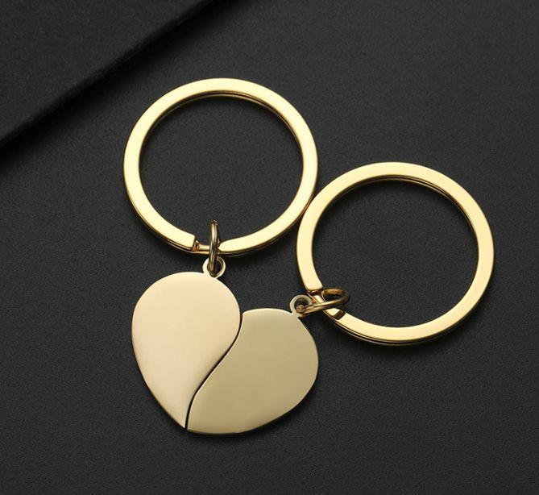
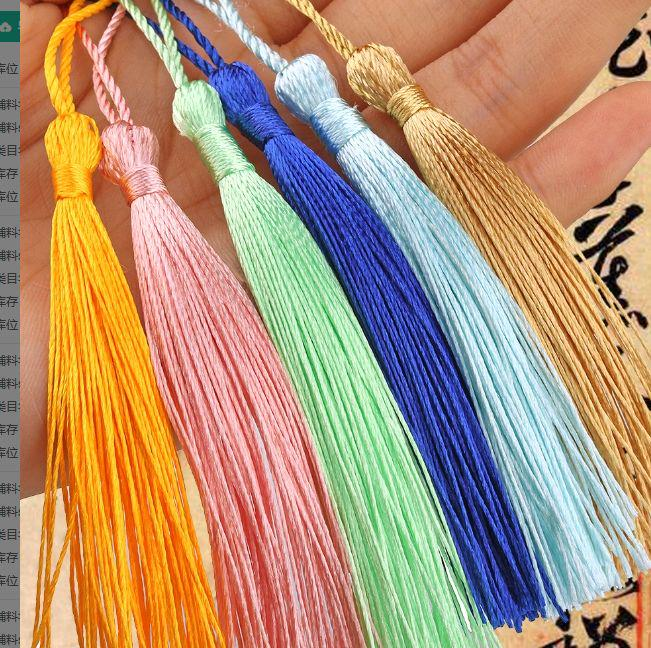
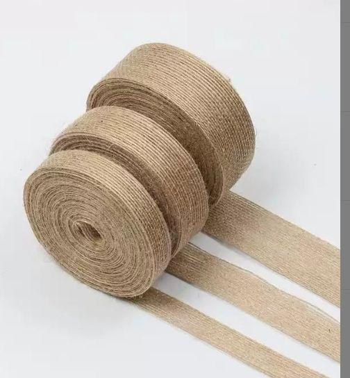
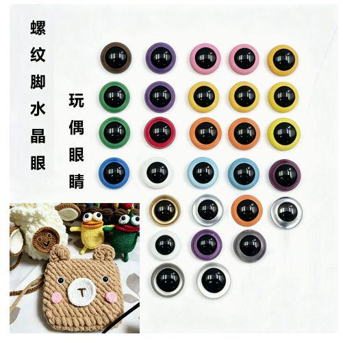
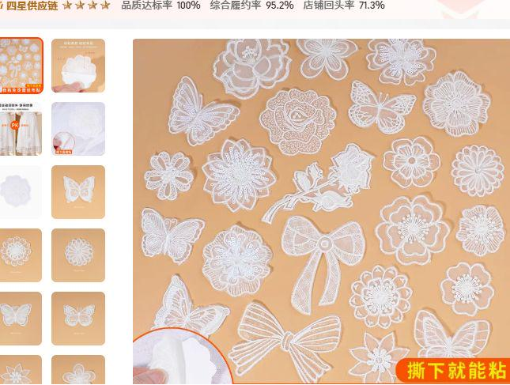
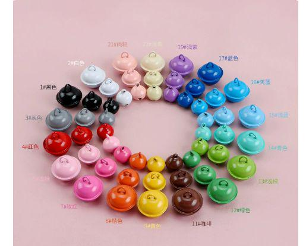
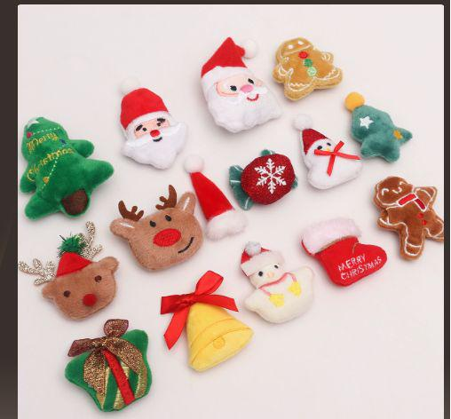
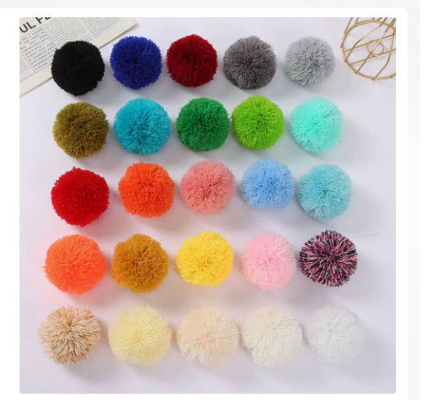
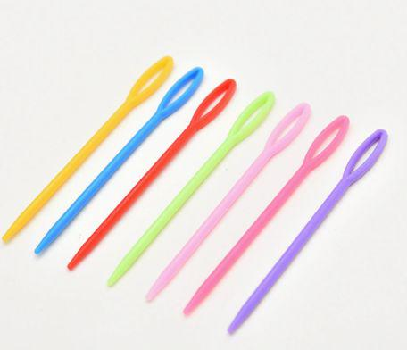
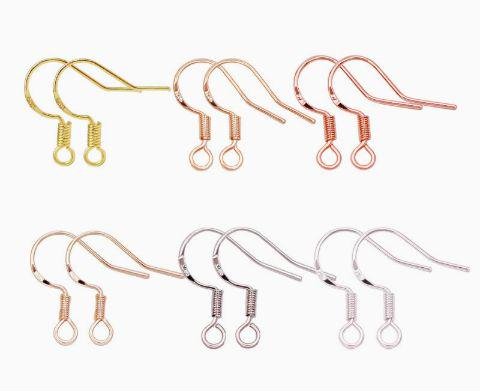

# 依柔工厂设备、工艺与配件离线资源

- 快照生成日期：2026-11-02（读取日期，不代表库存盘点日期）
- 来源文件：`E:/工作/2026/依柔工厂设备材料清单.xlsx`
- 来源 SHA256：`d638597244950af6dfec2999c26204f72bd0e81e4cbac703514b277513f57d75`

本地表格无法读取时直接使用本资源继续生成方案，并注明快照日期。原表空白以“—”表示，不代表零、不支持或无库存；字段原文保留，不自动补齐或纠正单位。图片来自工作簿内嵌图片，不是 AI 样品图。

## 使用时需要核对的字段

- 设计与 BOM 优先匹配合适的已有配件，注明配件编号、用途、颜色/规格、单套用量；库存数量与价格为空时标为待核实。
- 未编号设备可以按设备名及来源行引用，不自行生成 YR 编号。机器工作范围不等于所有列出材料均适用于当前加工路径。
- 设备参数、材料单位或规格含义异常时保留原值并标记待核实；可继续完成不依赖该参数的设计。

## 数据目录

- 设备工艺：38 条记录
- 钩织工艺：8 条记录
- 配件清单：10 条记录

## 设备工艺

原表合并区域：B13:B15、B17:B19、B23:B24、B25:B33。仅在这些区域内解释共享标题，其他空白不继承。

| 原表行 | 编号 | 工艺类型 | 设备名 | 最大生产尺寸 | 能用的材料 |
|---|---|---|---|---|---|
| 2 | YR001 | 数码印花 | 数码打印机 | 1600mm | 聚酯纤维（200g仿棉拉架/230g牛奶丝双面磨毛/200g法国绒磨毛/140g牛奶丝/200g牛奶丝/140g牛奶丝黑色/200g冰丝/300g空气层/270g法兰绒/320g法兰绒/240g浴巾毛巾布/105g桃皮绒斜桃/105g桃皮绒防水斜桃/210g仿麻/240g水晶超柔/8安帆布/12安帆布/600D牛津布防水） |
| 3 | YR002 | 热转印 | 滚筒热转印 | 1600mm | 聚酯纤维（200g仿棉拉架/230g牛奶丝双面磨毛/200g法国绒磨毛/140g牛奶丝/200g牛奶丝/140g牛奶丝黑色/200g冰丝/300g空气层/270g法兰绒/320g法兰绒/240g浴巾毛巾布/105g桃皮绒斜桃/105g桃皮绒防水斜桃/210g仿麻/240g水晶超柔/8安帆布/12安帆布/600D牛津布防水） |
| 4 | YR003 | 热转印 | 台面热转印 | 400x600mm | 聚酯纤维/白墨烫画压印/小物件半成品加工 |
| 5 | YR004 | 面料激光切割 | 面料激光裁切机 | 1600x2000mm | 相机定位激光切割已转印面料 |
| 6 | YR005 | 胶印 | 白墨打印机 | — | 白膜转印纸 |
| 7 | YR006 | 帽子烫标 | 帽子烫标机 | — | 牛仔帽/网眼帽/棒球帽/遮阳帽 |
| 8 | YR007 | 马克杯热转印 | 五工位烫杯机 | — | 陶瓷热升华涂层马克杯-白底 |
| 9 | YR008 | 手机壳热转印 | 烫印机 | — | 热升华涂层手机壳-白底 |
| 10 | YR009 | 密绣 | 绣花机 | 400x500mm | 绣花线 |
| 11 | YR010 | 绣花 | 绣花机 | 400x500mm | 绣花线 |
| 12 | YR011 | 贴布绣 | 绣花机 | 400x500mm | 绣花线 |
| 13 | YR012 | UV打印 | 250平板UV打印机 | 1200x2400mm | 亚克力/雪弗板/纸张/PE板材/PC板材/PVC板材/玻璃/金属 |
| 14 | YR013 | — | 6090UV打印机 | 580x880mm | 亚克力/雪弗板/纸张/PE板材/PC板材/PVC板材/玻璃/金属 |
| 15 | YR014 | — | 6090UV打印机 | 580x880mm | 皮革/柔性布料 |
| 16 | YR015 | 户外写真 | 160户外写真机 | 1570mm | 弱溶剂涂层卷材（PE写真/合成纸/油画布/白胶车贴/黑胶车贴/其他卷材） |
| 17 | YR016 | 3D打印 | 拓竹3D打印机-H2C | 240x240x200mm | PLA材料 |
| 18 | YR017 | — | 拓竹3D打印机-P2S | 220x220x200mm | PLA材料 |
| 19 | YR018 | — | 拓竹3D打印机-P1S | 200x200x180mm | PLA材料 |
| 20 | YR019 | 覆膜 | 全自动覆膜机 | 1600mm | 160cm幅宽亮膜/哑光膜/镭射膜/雪花膜/双面胶 |
| 21 | YR020 | 织带打印 | 洗水标打印机 | 38mm | 涤纶丝带 |
| 22 | YR021 | 钩织 | 手工钩织 | — | 详细见钩织工艺表 |
| 23 | YR022 | 印刷 | 柯美打印机1085型 | 330mmx750mm | 75-250g白卡纸/75-220g铜版纸/70-180g牛皮纸 |
| 24 | YR023 | — | 柯美打印机6100型 | 330mmx510mm | 75-250g白卡纸/75-220g铜版纸/70-180g牛皮纸 |
| 25 | YR024 | 车缝设备 | 平车 | — | — |
| 26 | YR025 | — | 锁边机 | — | — |
| 27 | YR026 | — | 冚车 | — | — |
| 28 | YR027 | — | 同步车 | — | — |
| 29 | YR028 | — | 锁眼机 | — | — |
| 30 | YR029 | — | 钉扣机 | — | — |
| 31 | YR030 | — | 气眼机 | 1.2CM大小 | — |
| 32 | YR031 | — | 高车 | — | — |
| 33 | YR032 | — | 菊花眼机 | — | — |
| 34 | YR033 | 激光打标 | 20W激光打标机 | 15x15cm | 金属、漆面金属、木制品等产品激光刻字烧花 |
| 35 | YR034 | 激光内雕 | 紫外线激光内雕 | 10x10cm | K9水晶方块、水晶球内雕 |
| 36 | YR035 | 激光烧花 | 30W激光烧花机 | 20x20cm | 实木制品、纸张、塑料等激光刻印纹理 |
| 37 | YR036 | 震动刀切割 | 震动切割裁床 | 1200x2400cm | 可切割PVC板材、400g纸张、PE片材、瓦楞纸板、软性材料等 |
| 38 | YR037 | 水晶标贴 | 水晶标打印机 | 280mm | UV打印水晶标贴（彩白） |
| 39 | — | 刻字膜机器 | 刻字膜机器 | — | — |

## 钩织工艺

| 原表行 | 线材名称 | 规格 | 适合作品 | 推荐钩针 | 特点 & 备注 |
|---|---|---|---|---|---|
| 2 | 牛奶棉 | 4 股 | 玩偶、挂件、发夹、小花 | 2.0～2.5mm | 新手首选，颜色多，性价比高，轻微起球 |
| 3 | 牛奶棉 | 5 股 | 大玩偶、杯垫、包包、宝宝鞋 | 2.5～3.0mm | 比 4 股厚实挺括 |
| 4 | 蕾丝线 | 8 号、10 号 | 微钩小花、发饰、耳环 | 0.8～1.2mm | 精致小件，新手容易费手 |
| 5 | 空心棉（圆股线） | 常规 | 夏日包包 | 3.5～4.0mm | 顺滑不软塌，适合包 |
| 6 | 冰条线 | 单股粗线 | 拖鞋、厚围巾 | 4.5～6.0mm | 毛绒感，针目不好看清 |
| 7 | 布条线 | 宽布条 | 托特包、收纳筐、地垫 | 5.0～8.0mm | 粗大件，成品立体 |
| 8 | 马海毛 / 圈圈纱 | 常规 | 帽子、毛衣、氛围感披肩 | 按线粗细选 | 毛感强，看不清针目，劝退新手 |
| 9 | 羊毛混纺线 | 细 / 中粗 | 毛衣、披肩 | 3.0～4.5mm | 保暖有弹性，价格偏高 |

## 配件清单

| 原表行 | 图片 | 配件名 | 配件编号 | 尺寸 | 颜色 | 简单说明用途 | 编号 | 库位 | 价格 | 采购链接 | 供应商 | 供应商联系方式 |
|---|---|---|---|---|---|---|---|---|---|---|---|---|
| 2 | [配件图片](../assets/accessories/PJ001.png) | 不锈钢拼心心形钥匙扣金色 | PJ001 | — | 金色/ 银色/玫瑰金 | 搭配包包作为挂饰 | — | ZFT-F2-I1-4 | — | — | — | — |
| 3 | [配件图片](../assets/accessories/PJ002.png) | 流苏 | PJ002 | 8 CM | 绿色  | — | — | KF-004-002-1005-4-3 | — | — | — | — |
| 4 | [配件图片](../assets/accessories/PJ003.png) | 鱼丝麻布 | PJ003 | 1.5-2-3 | 黄色 | 做蝴蝶结 | — | KF-004-002-1003-3-5 | — | — | — | — |
| 5 | [配件图片](../assets/accessories/PJ004.png) | 动物玩具水眼睛 | PJ004 | 7MM-45mm | 多色 | 做玩偶配饰眼睛 | — | — | — | https://detail.1688.com/offer/1049994921538.html?spm=a26352.13672862.offerlist.12.46541e624bBwN7&sortType=&pageId=&abBizDataType=cbuOffer&hotSaleSkuId=6081690117803&trace_log=normal&uuid=9cbf1967c1544229b7718614816aeff1&sourceId=V1-1f4a4f55b993d83461d0e6e43b5c41fc-S02 | 1688 | — |
| 6 | [配件图片](../assets/accessories/PJ005.png) | 蕾丝刺绣装饰布贴 | PJ005 | — | 白色  | 配件  | — |   | — | https://detail.1688.com/offer/794476587222.html?spm=a262uh.11734184.footprint-offer-list-offer18.2.30772ef6d6fK2r | 1688 | — |
| 7 | [配件图片](../assets/accessories/PJ006.png) | 4-22mm彩色烤漆铃铛挂件 | PJ006 | — | 多色 | 配件 | — | — | — | https://detail.1688.com/offer/818502332037.html?spm=a26352.13672862.offerlist.8.28151e62yhNvMY&sortType=&pageId=&abBizDataType=cbuOffer&hotSaleSkuId=5795621533063&trace_log=normal&uuid=e9838da23464465fa38b6882723fc4c5&sourceId=V1-1f4a4f55b993d83461d0e6e43b5c41fc-S02 | 1688 | — |
| 8 | [配件图片](../assets/accessories/PJ007.png) | 圣诞系列毛绒玩偶配件 | PJ007 | — | 多款式 | 配件 | — | — | — | https://detail.1688.com/offer/1064545667506.html?spm=a260k.home2025%2F2026.homelist_cccg.offer | 1688 | — |
| 9 | [配件图片](../assets/accessories/PJ008.png) | 彩色开司米毛球 | PJ008 | 3-7CM | 多色 | 配件 | — | — | — | https://detail.1688.com/offer/549422064611.html?spm=a260k.home2025%2F2026.homelist_cccg.offer | 1688 | — |
| 10 | [配件图片](../assets/accessories/PJ009.png) | 穿针 | PJ009 | 5.5-9CM | 多色 | — | — | — | — | https://detail.1688.com/offer/629495450984.html?spm=a360q.8274423%2Fnew.goods.productimage | — | — |
| 11 | [配件图片](../assets/accessories/PJ010.png) |  925纯银耳钩银配饰耳坠配件 | PJ010 | — | 金/银/玫瑰金 | 耳饰配件 | — | — | — | https://detail.1688.com/offer/707531649028.html?spm=a260k.home2025%2F2026.homelist_cccg.offer | — | — |

## 配件图片索引

### PJ001 不锈钢拼心心形钥匙扣金色

### PJ002 流苏

### PJ003 鱼丝麻布

### PJ004 动物玩具水眼睛

### PJ005 蕾丝刺绣装饰布贴

### PJ006 4-22mm彩色烤漆铃铛挂件

### PJ007 圣诞系列毛绒玩偶配件

### PJ008 彩色开司米毛球

### PJ009 穿针

### PJ010  925纯银耳钩银配饰耳坠配件

